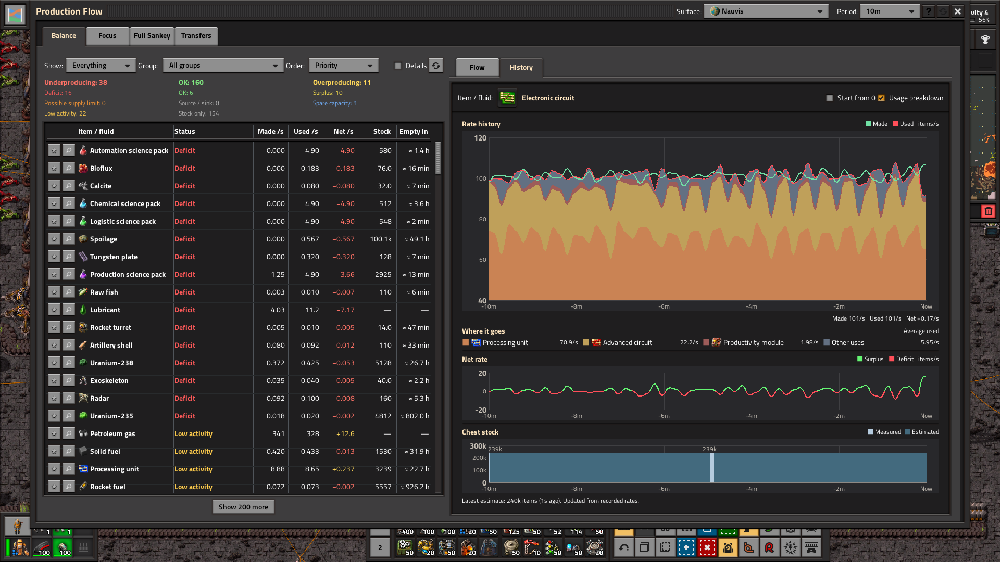
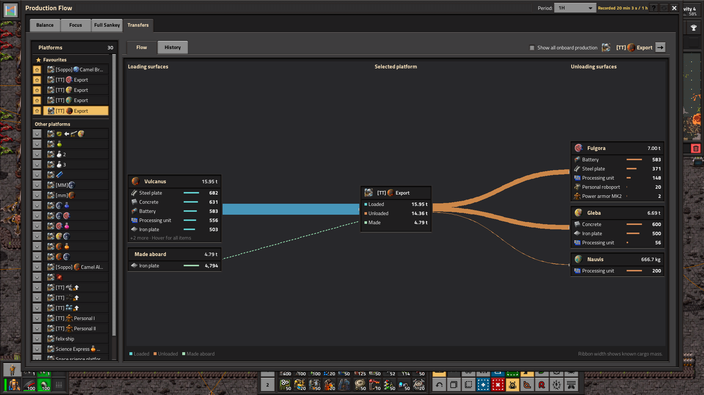

# Production Flow

**Production balances and interactive Sankey charts for Factorio.**

Production Flow shows what your factory makes, what it consumes, and how recipes
connect on the selected surface. In Space Age, it also tracks cargo deliveries
between planets and space platforms.

**Feedback needed:** Help shape the beta by sharing what works, what is confusing,
and what needs improving. Report bugs or suggest improvements on
[GitHub Issues](https://github.com/TTLouis/factorio-production-flow/issues) or the
[Mod Portal discussion](https://mods.factorio.com/mod/production-flow/discussion).

The **0.2.5 beta** focuses on Balance History and Space Age Transfers.
See [the changelog](CHANGELOG.md).

## Views

Charts default to individual item and fluid names. Optional grouping and
the layout of dense charts are still being refined.

- **Balance.** Find shortages and explore what makes and uses the selected item
  or fluid. Switch from Flow to History to compare production, use, net rate
  and chest stock on the same timeline.
- **Transfers.** Follow confirmed Space Age cargo deliveries by platform.
  Explore route manifests or switch to History to see when each pod arrived.
- **Focus.** Trace upstream and downstream recipe connections for one material.
- **Full Sankey.** Explore the broader recipe network on the selected surface.

Destination/source colors, hover highlighting, pinned selections, optional labels,
Fit and Center help you explore the charts. Automatic updates preserve selectors and
row positions; use the **Refresh table** icon to reapply list ordering and filters. The **?**
button opens in-game help for controls, calculations, alerts and stock.
Choose a **Period** from one minute to 1,000 hours. The default is ten minutes.
History survives saving and loading. A warm-up indicator shows how much time
has been recorded so far.




## Install

Requires **Factorio 2.1**. Tested with Factorio **2.1.24** and a Space Age save,
including planetary and local space-platform production.

Install [Production Flow from the Mod Portal](https://mods.factorio.com/mod/production-flow),
or download the ZIP from the
[GitHub releases](https://github.com/TTLouis/factorio-production-flow/releases)
and place it in your Factorio mods directory.
Open Production Flow in-game, select a surface, and inspect a Balance row with
its magnifier button. Expand inputs to follow its recipe chain upstream.
In Focus, use the magnifier in the toolbar to search for an item or fluid.

## What the charts measure

Production charts show recipe relationships based on observed crafting and
production statistics. Transfers tracks cargo delivered between surfaces.
Stock covers ordinary and logistic chests on the selected surface, including
requester and buffer chests, across all qualities. Chests outside a logistic
network count too. Production measurements work independently of chest storage.
Player/vehicle inventories, machine buffers, belts, ground items, linked/infinity
chests and fluid tanks are excluded. Empty-time values are estimates. Large maps
use staggered inventory scans, publishing only completed results. Each scan is
followed by the cooldown selected in Mod settings / Map (1-minute minimum,
5-minute default); Balance shows stock sample age and the selected interval.

See [how rates are calculated](docs/calculations.md) for the measurements,
productivity adjustments, utilisation estimates and stock calculations.

Compressed widths, minimum visible thickness and separate fluid scaling help
readability; they are not a conserved mass balance across different materials.
Dense charts can still cross or require scrolling. Modpack compatibility,
multiplayer and large-factory performance need broader testing.

## Development

Python 3.11+ is sufficient for the offline test and packaging commands:

```sh
python -m pip install -r requirements-dev.txt
python tests/run_lua.py
python tools/build.py
```

The test harness uses Lupa's Lua 5.2 runtime. It checks Lua syntax, sampling,
recipe APIs, layout, Balance, Focus and Full Sankey behavior with synthetic data.
The game is needed for native GUI validation; see [development notes](docs/development.md).
Publishing a GitHub release runs the validation and Mod Portal publishing workflow.
Ordinary development pushes do not publish.

`mod/production-flow/` is the installable source. `tests/` contains the offline
harness and optional native runners. Build output, private saves, diagnostic
exports and local preview galleries are excluded from Git.

## Feedback and contributions

Player feedback is especially useful for:

- Balance controls, labels and numbers that are unclear or look incorrect.
- Focus and Full Sankey layout, navigation and readability on real factories.
- Modpack compatibility, multiplayer behavior and large-factory performance.

Share feedback on [GitHub Issues](https://github.com/TTLouis/factorio-production-flow/issues)
or the [Mod Portal discussion](https://mods.factorio.com/mod/production-flow/discussion).
For bugs, include the Factorio/mod versions, relevant mods, surface, time window,
material or recipe, steps to reproduce, expected and actual behavior, and a
screenshot if possible. For slowdowns, include your factory size and whether the
Production Flow window was open. General impressions and suggestions are welcome
too; you do not need a full bug report to share them.

For code contributions, see [CONTRIBUTING.md](CONTRIBUTING.md).

## License

[MIT](LICENSE), copyright 2026 TTLouis. Factorio and the game artwork depicted in
screenshots belong to their respective owners.
