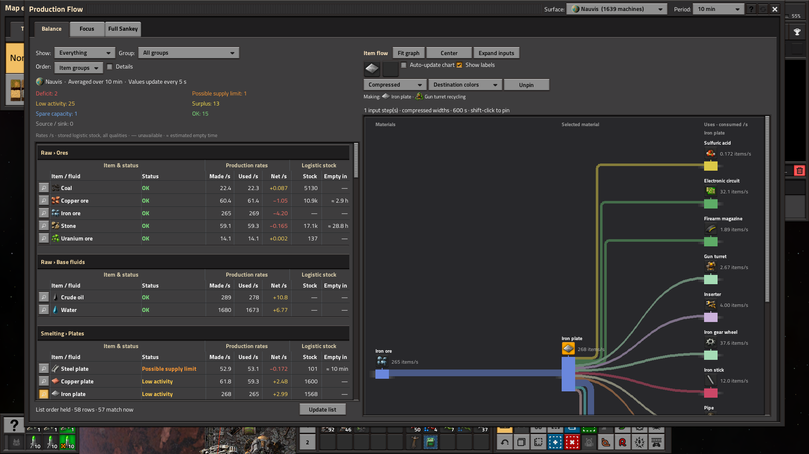
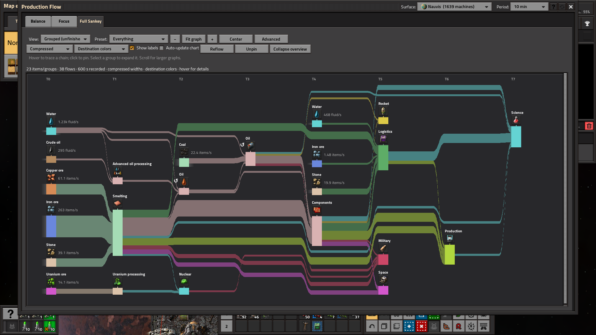

# Production Flow

**Production balances and interactive Sankey charts for Factorio.**

Production Flow shows what your factory makes, what it consumes, and how recipes
connect on the selected surface. Beta candidate: **0.1.1**, by **TTLouis**.

## Views

Charts default to individual item and fluid names. Graph grouping is optional
and unfinished. Balance is the main focus of this beta. Focus and Full Sankey still need layout,
navigation and readability improvements, especially on dense factories.

- **Balance:** Made, used and net rates, logistic stock, and an item/fluid inspector.
  Uses show consumption of the selected material. Filters stay fixed while the
  list scrolls vertically. Details stack within rows; dividers separate columns,
  rows and item groups.
- **Focus — needs more polish:** Upstream and downstream recipe connections around one material.
- **Full Sankey — needs more polish:** Grouped production overview, expandable materials and presets.

Destination/source colors, hover highlighting, pinned selections, optional labels,
Fit and Center help you explore the charts. Automatic updates preserve selectors and
row positions; use **Update list** to reapply list ordering and filters. The **?**
button opens in-game help for controls, calculations, alerts and stock. **Recent**
sets a short averaging period; **Auto-update chart** only controls chart redraws.
The default measurement window is
**10 minutes**. History survives saves; new installations show a warm-up indicator as it accumulates.




## Install

Requires **Factorio 2.1**. Tested with Factorio **2.1.23** and a Space Age save,
including planetary and local space-platform production.

The beta is being prepared for publication. For a local installation, build the
ZIP below and place `production-flow_0.1.1.zip` in your Factorio mods directory.
Open Production Flow in-game, select a surface, and inspect a Balance row with
its magnifier button. Expand inputs to follow its recipe chain upstream.

## What the charts measure

Flows combine observed crafting activity, production statistics and recipe
relationships. They do not trace belts, pipes or individual shipments.
Interplanetary logistics tracking is not included. Stock covers logistic
provider and storage inventories across all qualities, including robot pickup
reservations. Other chests, requester inventories, items in transit and fluid
tanks are excluded. Empty-time values are estimates.

See [how rates are calculated](docs/calculations.md) for the measurements,
productivity adjustments, utilisation estimates and stock calculations.

Compressed widths, minimum visible thickness and separate fluid scaling help
readability; they are not a conserved mass balance across different materials.
Dense charts can still cross or require scrolling. Modpack compatibility,
multiplayer and large-factory performance need broader testing.

Diagnostic files remain local under `script-output/production-flow`. Automatic
exports are optional and off by default for new installations. Manual exports
and renderer comparisons are available only with debug controls enabled. Nothing
is uploaded automatically.

## Development

Python 3.11+ is sufficient for the offline test and packaging commands:

```sh
python -m pip install -r requirements-dev.txt
python tests/run_lua.py
python tools/build.py
```

The test harness uses Lupa's Lua 5.2 runtime. It checks Lua syntax, sampling,
recipe APIs, layout, Balance, Focus and Full Sankey behavior with synthetic data.
The game is needed for native GUI validation; see [development notes](docs/development.md).

`mod/production-flow/` is the installable source. `tests/` contains the offline
harness and optional native runners. Build output, private saves, diagnostic
exports and local preview galleries are excluded from Git.

## Feedback and contributions

Include the Factorio/mod versions, surface, time window, material or recipe,
expected behavior and a screenshot when reporting an issue. See
[CONTRIBUTING.md](CONTRIBUTING.md).

## License

[MIT](LICENSE), copyright 2026 TTLouis. Factorio and the game artwork depicted in
screenshots belong to their respective owners.
