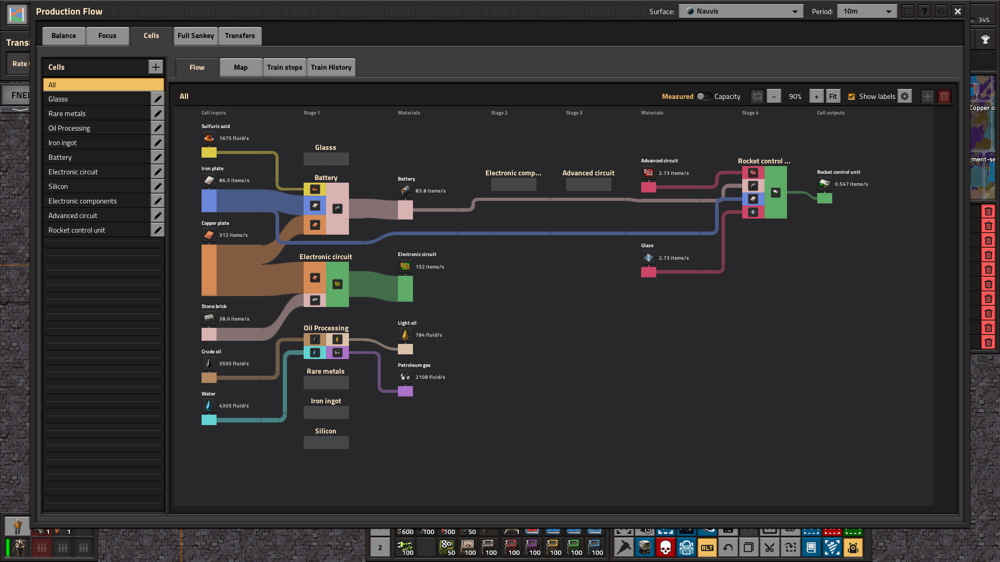
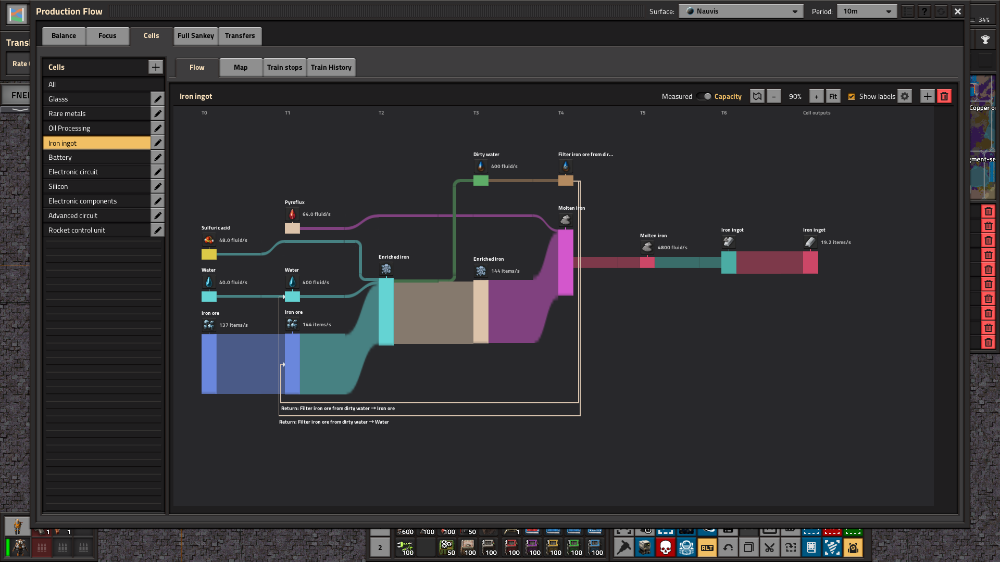
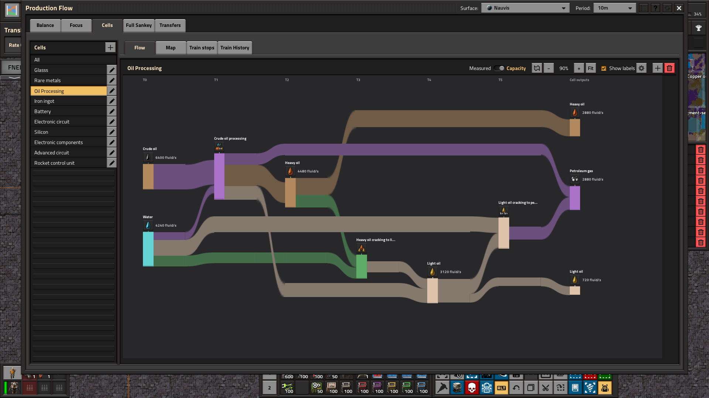
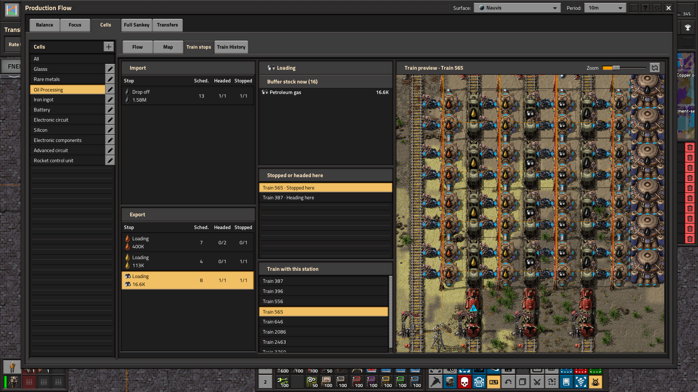
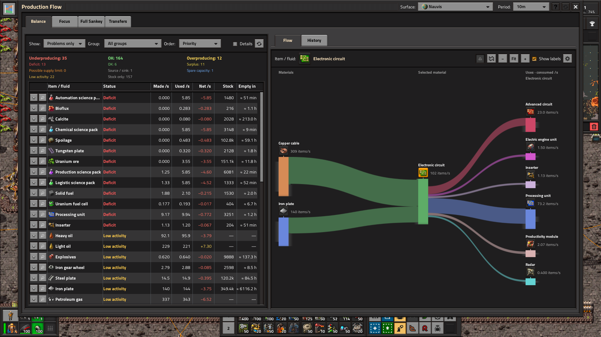
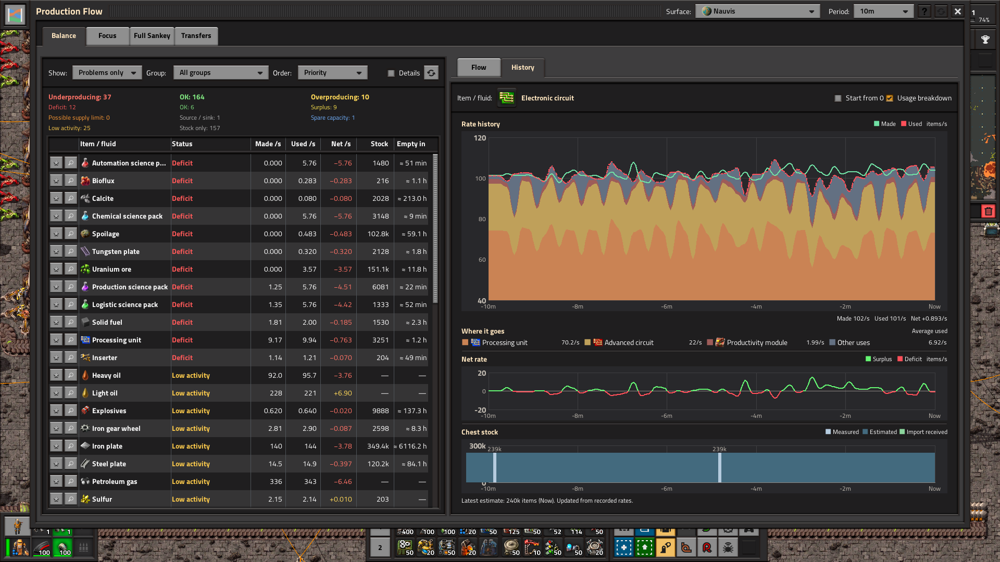
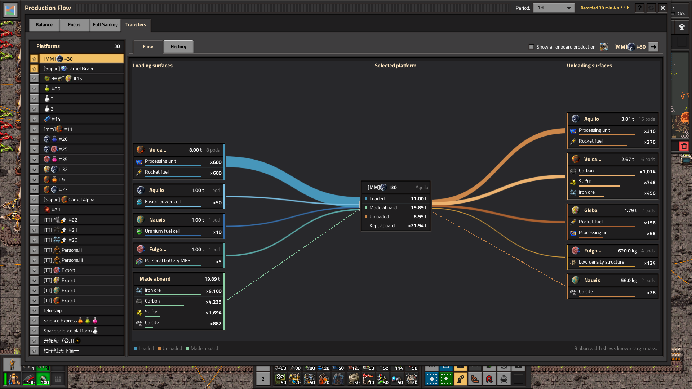
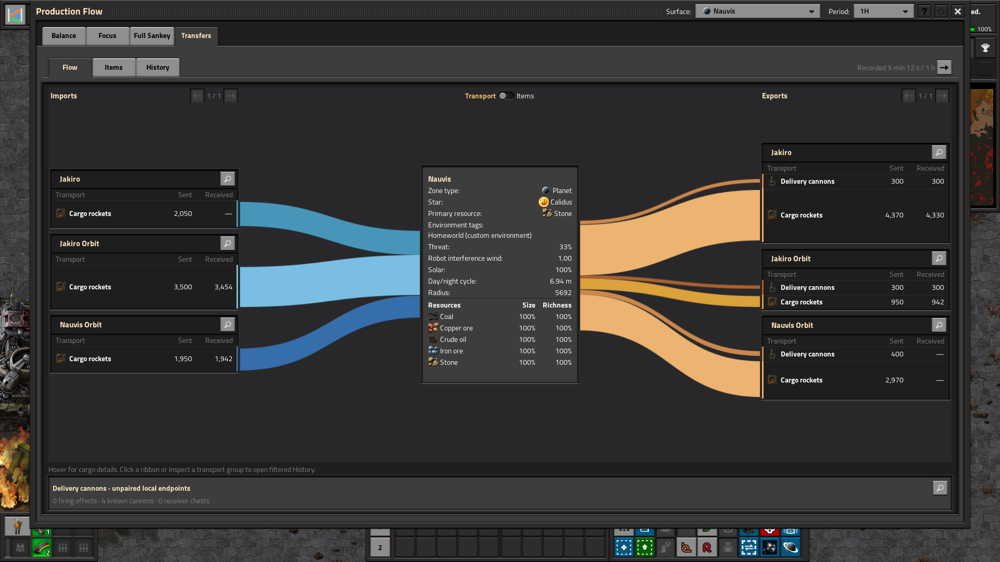
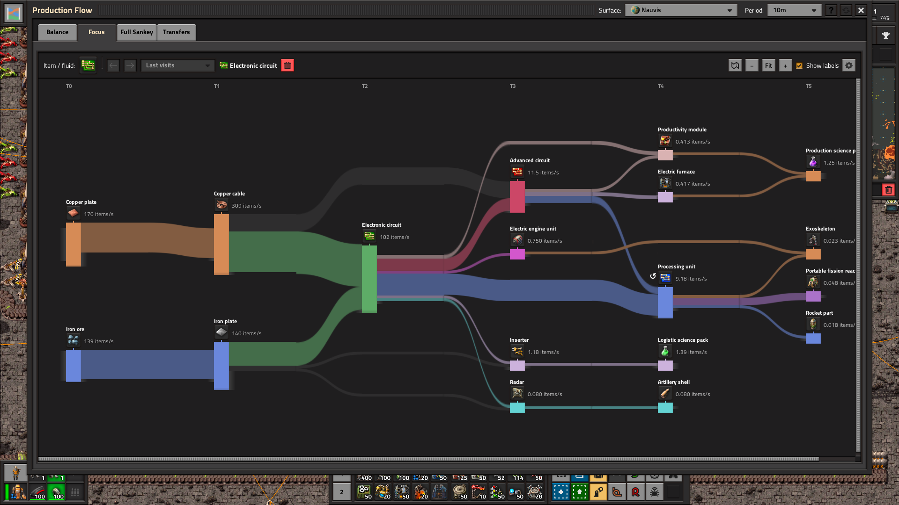
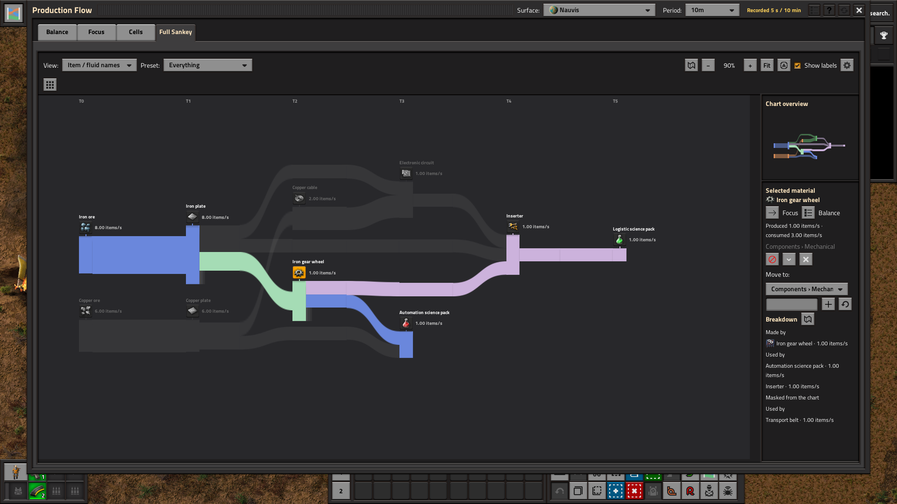

# Production Flow

This file supplies the next Mod Portal description. The screenshots are native Factorio 2.1.24 captures at 100% UI scale.

## Short description

Spot production shortages with interactive Sankey charts, item and fluid history, and chest stock tracking. Transfers follows Space Age cargo deliveries and Space Exploration cargo rockets and delivery cannons.

## Mod page description

**Where did all your green circuits go?** Follow the recipes using them, see whether production is keeping up, and check how long your chest stock will last. Group your machines into production cells to see how each part of the factory supplies the next.

**Supported game setups** include base Factorio, Space Age, and Space Exploration. Balance, Focus, Cells, and Full Sankey are available in all three. The optional Space Age and Space Exploration integrations add their own **Transfers** views.

Available in English, Simplified Chinese (简体中文), and Traditional Chinese (繁體中文). All views, mod settings, help, tooltips, and alerts follow your Factorio language setting.

**支持简体中文和繁體中文。** 界面会跟随 Factorio 的语言设置，无需另装汉化模组。

**Feedback needed:** Try Production Flow in your factory and share what works, what is confusing, or what you would like improved. Feedback on Balance, chart readability, mod compatibility and performance is especially helpful. Leave a message in the [Mod Portal discussion](https://mods.factorio.com/mod/production-flow/discussion) or [GitHub Issues](https://github.com/TTLouis/factorio-production-flow/issues). For bugs, include your Factorio/mod versions, what you expected, what happened and a screenshot if possible.

### Group your factory into production cells

Open **Cells**, click **+**, and drag over a production area. The editor suggests a name, an icon, inputs and outputs, and can link train stops and storage in the selection. Click **?** beside **+** for the creation guide, including how item or fluid icons in stop names help match storage. Adjust the suggestions to match your setup, and divide larger builds into smaller cells when you want to inspect their stages separately.

- **Flow** shows what a cell takes in and makes. Switch between **Measured** and **Capacity** to compare recorded production with what the machines could make at full speed. Choose **All** to compare net inputs and outputs across production stages.
- **Map** shows where the cell's machines, train stops and buffers are. See their outlines in the world and on the map, then jump to the area in remote view.
- **Train stops** shows stock in linked chests and tanks, which trains are scheduled, approaching or stopped, and how many trains the stop can accept. Select a train to preview it or jump to it.
- **Train History** shows when trains loaded or unloaded and how much cargo changed during recorded automatic visits. Switch between elapsed time and individual exchanges, then expand a visit to see amounts by item quality and fluid.

Machines upgraded or rebuilt in the same spot can rejoin their cell. In Space Exploration, cells can follow a spaceship during launch or landing when their machines move together.

### Balance production and stock

Sort items and fluids by deficit or time to empty, then select one to inspect what makes and uses it. Star materials or groups to keep them handy, and set watches for a minimum production rate or time to empty.

The Underproducing, OK and Overproducing summaries help you scan the factory at a glance. Turn on **Details** to see utilisation and stock trends. The headings and filters stay visible as you scroll. Use **Refresh table** to reapply your filters and sort order.

Click the material slot to search for an item or fluid. Browse familiar item categories or jump straight to the Fluids section.

Switch to **History** to compare Made, Used, Net, estimated use by product and chest stock for the same material. Hover to line up the charts at one point in time. Choose a production period from one minute to 1,000 hours.

### Follow platform cargo in Space Age

Pick a space platform in **Transfers → Flow** to see where it loads and unloads cargo. Follow the ribbons to inspect what moved on each route. The platform card shows how much was loaded, made aboard, unloaded, and kept aboard. Star your regular platforms to keep them at the top.

Open **History** to see when cargo moved. Switch to **Time** to see the gaps between deliveries, or **Events** to put recorded cargo exchanges side by side. Expand a delivery in the log to see what was in the pod.

### Track shipments in Space Exploration

- **Flow** maps cargo rocket and delivery cannon routes into and out of the selected surface. Group routes by **Transport** or **Items**, then click a ribbon to open its shipment history.
- **Items** compares quantities sent and received with local production, usage, and chest stock. Select a material to see how its supply and stock changed over time.
- **History** shows shipments by elapsed **Time** or as a compact sequence of **Events**. Expand a shipment to see its contents and any measured losses. Jump to the sender or receiver when its location is available.

Received quantities are measured when a rocket lands on a pad with enough room or a delivery chest catches a cannon package. Receipts stay unknown for full-pad landings, off-pad landings, and spilled packages. Delivery cannon tracking requires Space Exploration 0.7.64.

### Explore recipes and inspect machines

Use **Focus** to trace the inputs and consumers of one item or fluid. Open **Machine status** from Balance or Focus to check for missing inputs, blocked outputs or power issues, and preview a machine before jumping to it.

Use **Back**, **Forward** or **Last visits** to revisit materials in Focus. Zoom, Fit and Show labels are on the chart toolbar. Hover a ribbon to see its total flow and rates by recipe, or use the gear for more chart settings.

**Full Sankey** shows recipe flows across one surface. Click a material in the chart overview to jump to it. Zoom in for detail or use **Fit** to bring the chart into view. In **Selected material**, the **Breakdown** lists recipes that make or use the material, including active recipes hidden from the chart. Open **Focus**, **Balance**, or **Machine status** from there to investigate further.

Large **Cells Flow** and **Full Sankey** charts show up to 150 nodes and 300 links. Use **Refresh** to update an oversized chart. Enable **Bypass Sankey size limit** in the save’s map mod settings to draw the full chart on refresh.

Hover a recipe bar to see recipe amounts, rates and the machines running it. Thin return arrows show flows that loop back, such as recycling or circulating catalysts.

### How the calculations work

- **Made, Used and Net.** Made and Used are changes in Factorio's production counters for the selected surface, divided by the recorded duration. Net is Made minus Used. The default period is ten minutes. While a period fills, rates use the history recorded so far. That history survives saving and loading.
- **Recipe connections.** Production Flow samples completed crafts on tracked machines. It uses ingredient amounts and expected product yields to estimate rates for each recipe link, accounting for productivity and the expected yield of probabilistic outputs. Recipe estimates can differ from the measured totals.
- **Selected-material usage.** The **Uses** side shows how much of the selected material each recipe consumes. A recipe running at ten normal crafts per second and using two iron plates per craft consumes twenty iron plates per second.
- **Utilisation and status.** The mod compares observed normal craft rates with the capacity of the current machines, based on crafting speed and recipe time. A net difference within 5% of the larger Made or Used rate counts as roughly balanced. Machine, recipe or module changes can affect comparisons with historical activity. Treat utilisation warnings as clues about where to look.
- **Stock and Empty in.** Stock counts physical items in ordinary and logistic chests on the selected surface, including requester and buffer chests, across all qualities. Chests outside a logistic network count too. Items stored without recent activity appear as **Stock only**. Production rates refresh every five seconds. Chest reads are spread across ticks, with a configurable wait after each completed scan of one game minute minimum and five by default. A dash means stock is unavailable, and zero means measured empty. **Empty in** uses the recent drain from up to seven completed scans, or the net production deficit when no drain is measured. Seven scans span about 30 game minutes at the default interval or six at the minimum, with longer spans on large maps. Empty time assumes the current drain continues. Items moving between chests during a scan can affect the sample.
- **Ribbon widths.** Proportional mode scales widths by rate, while compressed mode uses the square root of the rate. Thin flows have a minimum visible width and fluids use a separate scale. Compare widths within the same material because different materials can use different units.

Open the **?** button in-game for help with controls, measurements and chart limits. See [how the calculations work](https://github.com/TTLouis/factorio-production-flow/blob/main/docs/calculations.md) for more detail.

### Compatibility and scope

Requires **Factorio 2.1**. Space Age and Space Exploration are optional integrations that enable Transfers. Production history and cargo tracking fill as the mod observes activity. Production charts show recipe relationships on a single surface, and Transfers records observed cargo shipments between surfaces, with the measurement limits described above. Broader modpack compatibility, multiplayer and large-factory performance are still being tested.

**Remove night vision tint** is enabled by default under **Settings → Mod settings → Startup**. It uses neutral colours throughout the game while night vision equipment is active. Night vision still brightens the scene, and the neutral palette can look brighter than the equipment's original palette. Turn it off and restart Factorio to restore the original look. Production Flow charts use their own palette in either mode.

Created by **TTLouis** under the **MIT license**. [Source code](https://github.com/TTLouis/factorio-production-flow)
