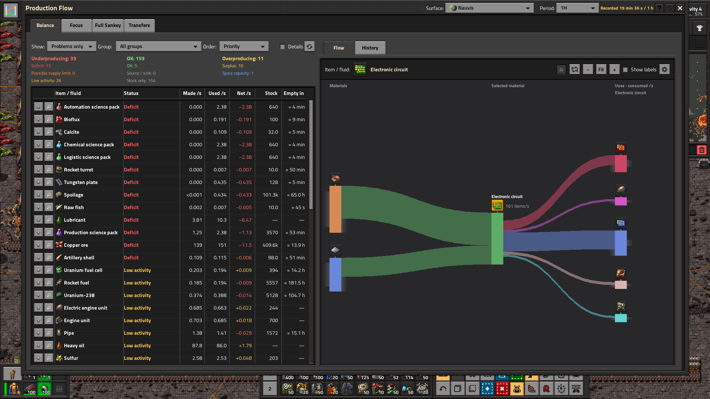
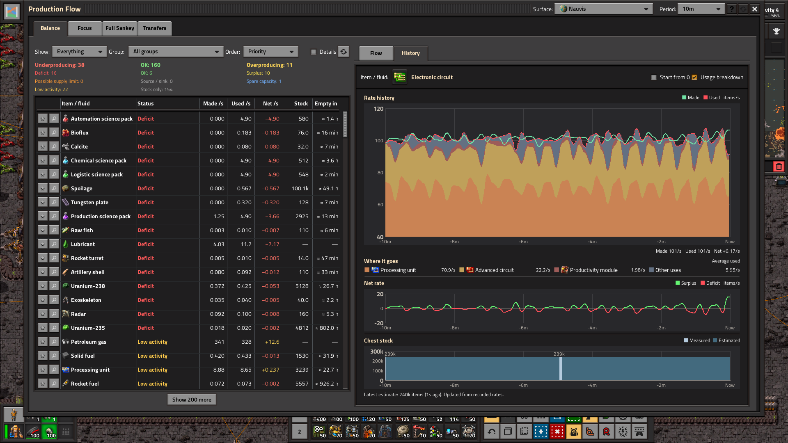
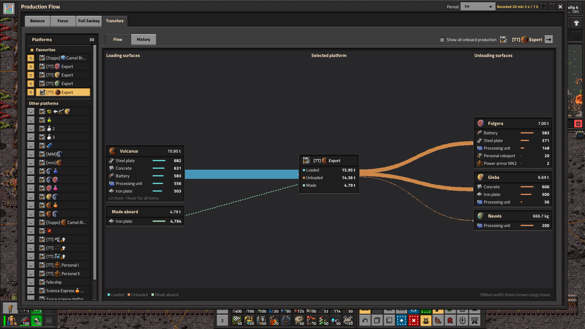
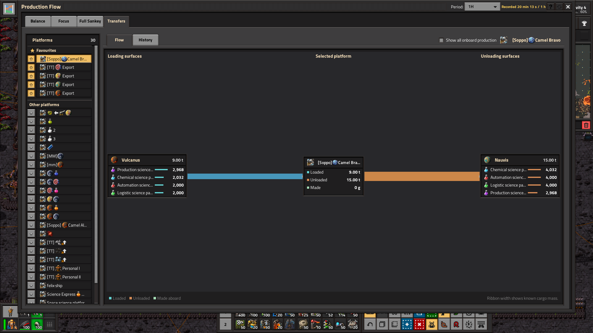
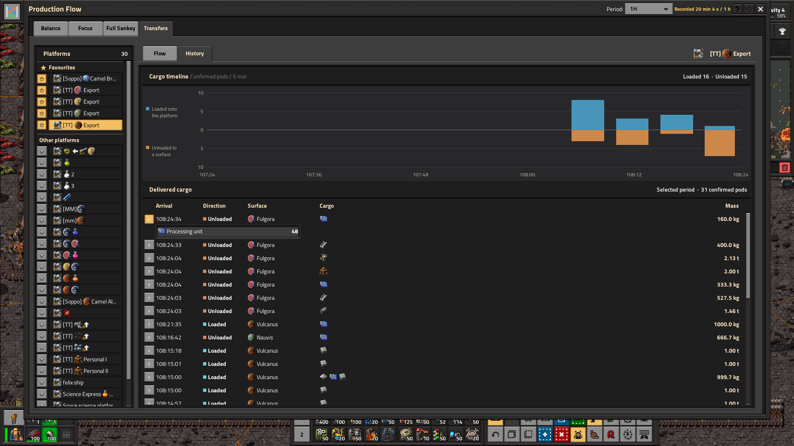
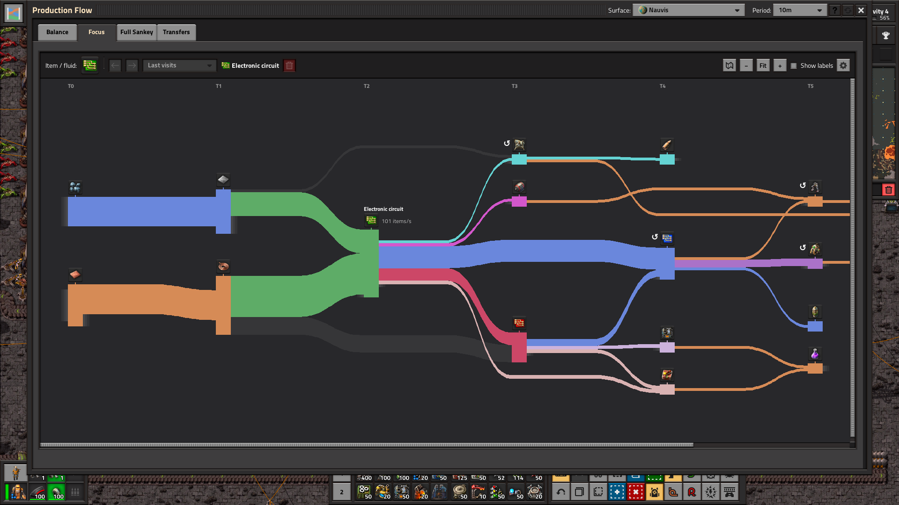
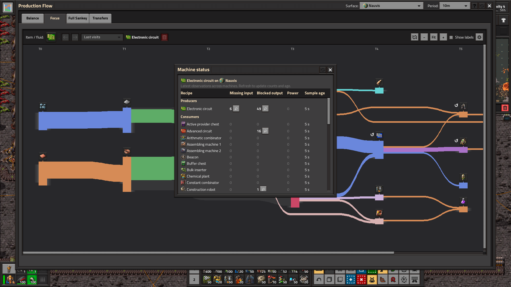
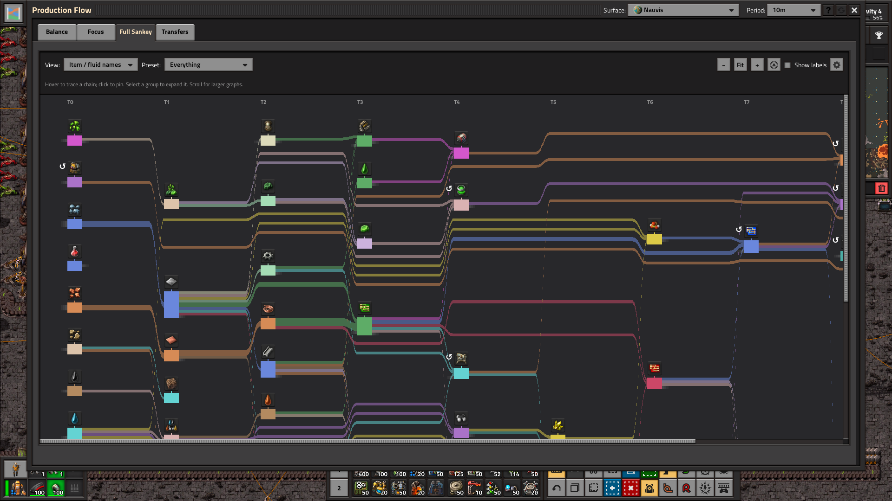

# Production Flow (Beta)

This file supplies the next Mod Portal description. The screenshots are native Factorio 2.1.24 captures at 100% UI scale.

## Short description

Spot production shortages with interactive Sankey charts, item and fluid history, and chest stock tracking. In Space Age, follow cargo deliveries between planets and space platforms.

## Mod page description

**Where did all your green circuits go?** Follow the recipes using them, see whether production is keeping up, and check how long your chest stock will last. In Space Age, follow cargo from the surface that loaded it to the one where it landed.

This beta focuses on the new **History** tab in Balance and the **Transfers** tab for Space Age cargo.

**New in 0.2.7: Simplified Chinese (简体中文) support.** Available in English and Simplified Chinese, including all views, mod settings, help, tooltips and alerts. The interface follows your Factorio language setting.

**现已支持简体中文。** 将 Factorio 的游戏语言设为简体中文即可使用，无需另装汉化模组。

**Feedback needed:** Try the beta in your factory and share what works, what is confusing, or what you would like improved. Feedback on Balance, chart readability, mod compatibility and performance is especially helpful. Leave a message in the [Mod Portal discussion](https://mods.factorio.com/mod/production-flow/discussion) or [GitHub Issues](https://github.com/TTLouis/factorio-production-flow/issues). For bugs, include your Factorio/mod versions, what you expected, what happened and a screenshot if possible.

### Balance production and stock

Sort items and fluids by deficit or time to empty, then select one to inspect what makes and uses it. Star materials or groups to keep them handy, and set watches for a minimum production rate or time to empty.

The Underproducing, OK and Overproducing summaries help you scan the factory at a glance. Turn on **Details** to see utilisation and stock trends. The headings and filters stay visible as you scroll. Use **Refresh table** to reapply your filters and sort order.

Click the material slot to search for an item or fluid. Browse familiar item categories or jump straight to the Fluids section.

Switch to **History** to compare Made, Used, Net, estimated use by product and chest stock for the same material. Hover to line up the charts at one point in time. Choose a production period from one minute to 1,000 hours.

### Follow cargo in Space Age

Pick a space platform in **Transfers** to see where it loaded and unloaded cargo. Follow the ribbons for each route and inspect what it carried. Star your regular platforms to keep them at the top.

Switch to **History** to see when cargo arrived. Select a time bucket to narrow the delivery log and expand a cargo pod to see its manifest.

### Explore recipes and inspect machines

Use **Focus** to trace the inputs and consumers of one item or fluid. Open **Machine status** from Balance or Focus to check for missing inputs, blocked outputs or power issues, and preview a machine before jumping to it.

Use **Back**, **Forward** or **Last visits** to revisit materials in Focus. Zoom, Fit and Show labels are on the chart toolbar. Hover a ribbon to see its total flow and rates by recipe, or use the gear for more chart settings.

**Full Sankey** gives you a broader view of recipe flows on one surface. Dense charts and optional grouping are still being refined.

### How the calculations work

- **Made, Used and Net.** Made and Used are changes in Factorio's production counters for the selected surface, divided by the recorded duration. Net is Made minus Used. The default period is ten minutes. While a period fills, rates use the history recorded so far. That history survives saving and loading.
- **Recipe connections.** Production Flow samples completed crafts on tracked machines. It uses ingredient amounts and expected product yields to estimate rates for each recipe link, accounting for productivity and the expected yield of probabilistic outputs. Recipe estimates can differ from the measured totals.
- **Selected-material usage.** The **Uses** side shows how much of the selected material each recipe consumes. A recipe running at ten normal crafts per second and using two iron plates per craft consumes twenty iron plates per second.
- **Utilisation and status.** The mod compares observed normal craft rates with the capacity of the current machines, based on crafting speed and recipe time. A net difference within 5% of the larger Made or Used rate counts as roughly balanced. Machine, recipe or module changes can affect comparisons with historical activity. Treat utilisation warnings as clues about where to look.
- **Stock and Empty in.** Stock counts physical items in ordinary and logistic chests on the selected surface, including requester and buffer chests, across all qualities. Chests outside a logistic network count too. Items stored without recent activity appear as **Stock only**. Production rates refresh every five seconds. Chest reads are spread across ticks, with a configurable wait after each completed scan of one game minute minimum and five by default. A dash means stock is unavailable, and zero means measured empty. **Empty in** uses the recent drain from up to seven completed scans, or the net production deficit when no drain is measured. Seven scans span about 30 game minutes at the default interval or six at the minimum, with longer spans on large maps. Empty time assumes the current drain continues. Items moving between chests during a scan can affect the sample.
- **Ribbon widths.** Proportional mode scales widths by rate, while compressed mode uses the square root of the rate. Thin flows have a minimum visible width and fluids use a separate scale. Compare widths within the same material because different materials can use different units.

Open the **?** button in-game for help with controls, measurements and chart limits. See [how the calculations work](https://github.com/TTLouis/factorio-production-flow/blob/main/docs/calculations.md) for more detail.

### Compatibility and scope

Requires **Factorio 2.1**. Space Age enables Transfers. Production history and cargo tracking fill as the mod observes activity. Production charts show recipe relationships on a single surface, and Transfers records confirmed cargo deliveries between surfaces. Broader modpack compatibility, multiplayer and large-factory performance are still being tested.

Created by **TTLouis** under the **MIT license**. [Source code](https://github.com/TTLouis/factorio-production-flow)
