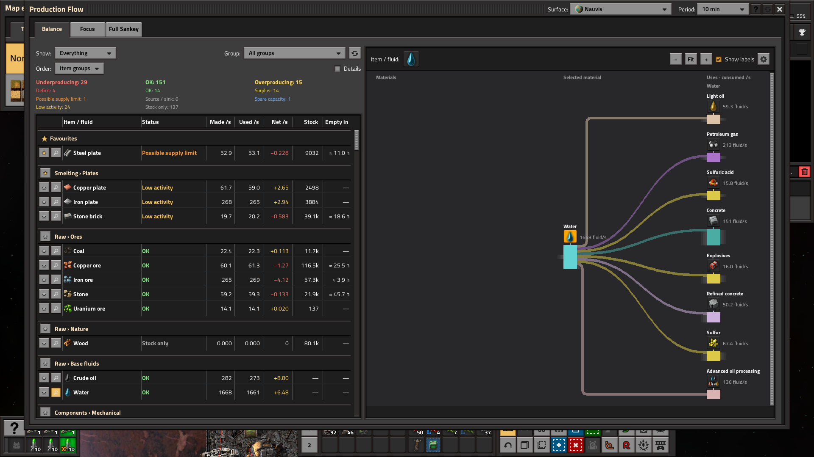
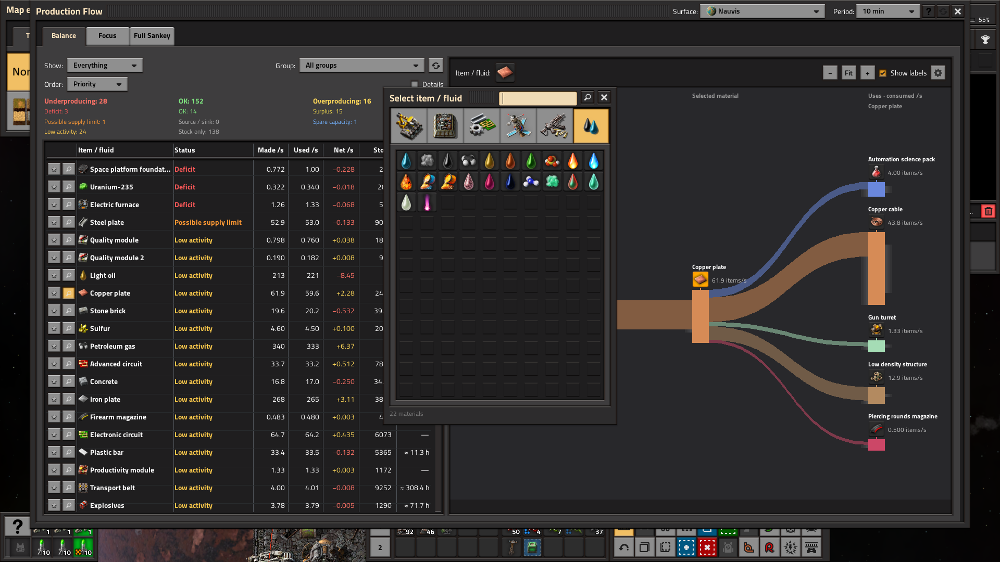
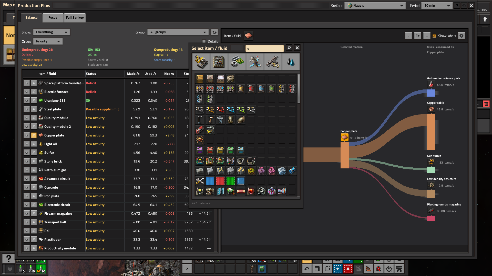
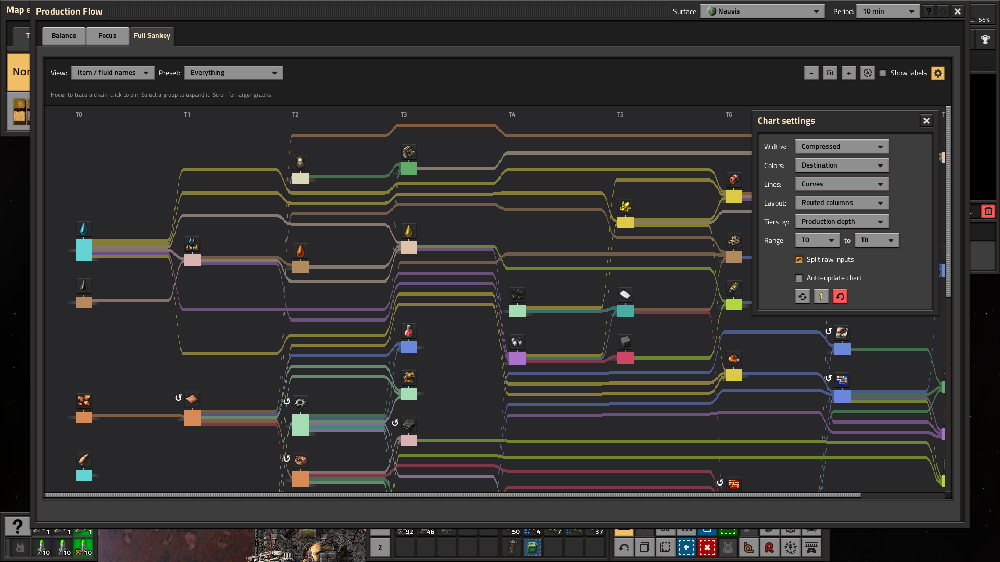

# Production Flow 0.1.3 — candidate UI preview

Prepared locally for review; not published. Native Factorio 2.1.23 captures at
1920×1080 and **100% interface size**. The captures come from the 0.1.3 upgrade
check against an isolated copy of the warmed 0.1.0 save. The native configuration
event confirms the 0.1.0 → 0.1.3 upgrade and retained ten-minute history.

## Balance controls and headings

Compact controls, three activity summaries, one fixed heading row aligned with the
data, 8 px before the scrollbar, and header Refresh. Details retain the same column alignment.

## Balance groups and favourites

Item and group stars keep favourites visible above the other rows.

## Combined item/fluid selector

Familiar categories plus Fluids, with side margins and no unused scrollbar.

## Scrolling material search

The scrollbar occupies the right-hand margin while the selector width stays fixed.

## Focus navigation

Back/Forward, six-material Last visits, clickable history and Clear.

## Chart settings

Zoom and labels stay visible. Less-used controls open over the chart, with a
bottom inset around the settings content.

